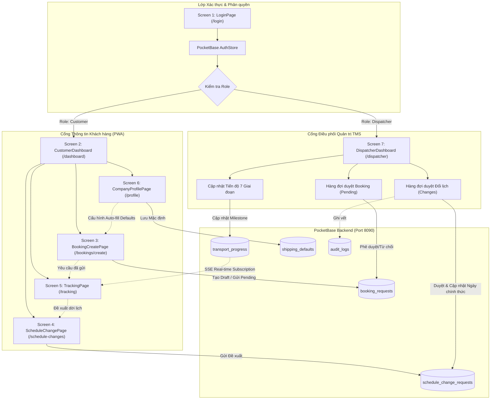
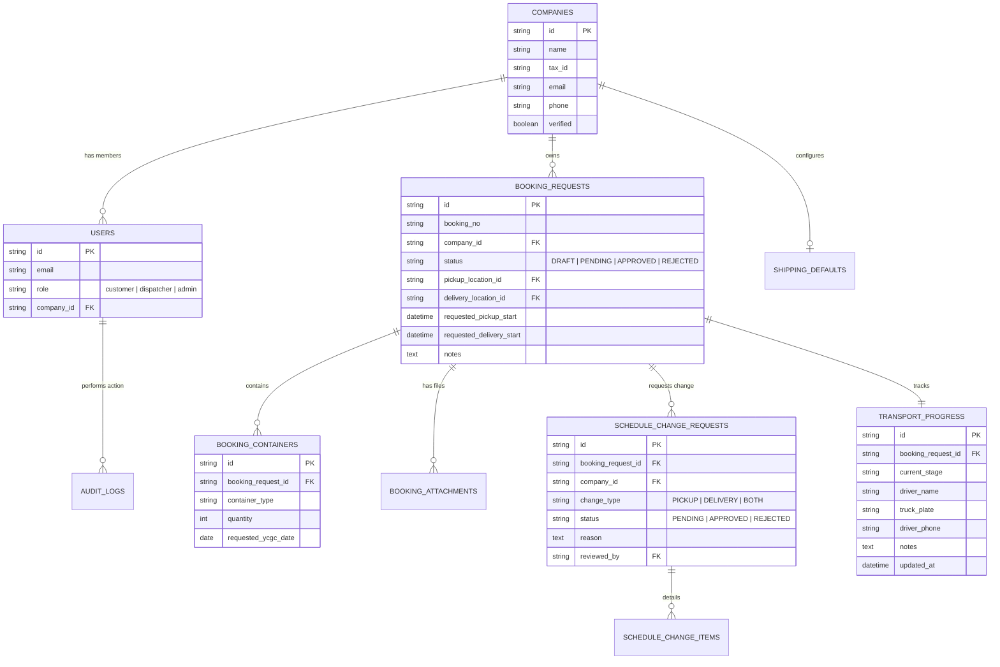

# TÀI LIỆU ÁNH XẠ MOCKUP VÀO HỆ THỐNG THÀNH PHẦN (MOCKUP TO COMPONENT MAPPING)
## Dự án: U&I Logistics Customer Portal & TMS Dispatcher System

---

## 1. BẢNG TỔNG THỂ ÁNH XẠ MOCKUP - ROUTE - COMPONENT - POCKETBASE

| STT | Màn hình Mockup | URL Route | React Components (Frontend) | PocketBase Collections & APIs | Quyền truy cập (RBAC) |
| :---: | :--- | :--- | :--- | :--- | :--- |
| **1** | **Screen 1**: Login<br>`U&I Logistics Customer Portal Login.png` | `/login` | `LoginPage`<br>`LoginForm`<br>`SSOButtons`<br>`PWAInstallCard` | `users`<br>`authWithPassword()` | Public / Chưa xác thực |
| **2** | **Screen 2**: Customer Dashboard<br>`U&I Logistics Customer Portal Dashboard.png` | `/` hoặc `/dashboard` | `CustomerDashboardPage`<br>`AppHeader`<br>`DashboardBanner`<br>`QuickActionCards`<br>`MetricsOverview`<br>`RecentRequestsList`<br>`BottomNavigation` | `booking_requests`<br>`schedule_change_requests`<br>`companies` | Customer (Isolate theo `company.id`) |
| **3** | **Screen 3**: Transport Request<br>`U&I Logistics Transport Request Form.png` | `/bookings/create`<br>`/bookings/:id/edit` | `BookingCreatePage`<br>`StepperHeader`<br>`GeneralInfoSection`<br>`TransportRouteSection`<br>`ContainerDynamicTable`<br>`AttachmentUploadZone`<br>`FormActionBar` | `booking_requests`<br>`booking_containers`<br>`booking_attachments`<br>`shipping_defaults`<br>`locations`<br>`container_types` | Customer (Tạo bản nháp `DRAFT`, gửi duyệt `PENDING`) |
| **4** | **Screen 4**: Time Change Proposal<br>`Vietnamese Logistics Time Change Proposal UI.png` | `/schedule-changes/create`<br>`/schedule-changes/:id` | `ScheduleChangeCreatePage`<br>`BookingSummaryCard`<br>`ChangeTypeSelector`<br>`NewScheduleInputs`<br>`ReasonTextArea`<br>`AttachmentList` | `schedule_change_requests`<br>`schedule_change_items`<br>`booking_requests` | Customer (Đề xuất thay đổi trên booking đang chạy) |
| **5** | **Screen 5**: Tracking Progress<br>`Logistics Tracking Progress Dashboard.png` | `/tracking`<br>`/tracking/:bookingId` | `TrackingDashboardPage`<br>`SearchFilterBar`<br>`RequestSummaryHeader`<br>`VerticalMilestoneTimeline`<br>`TransportExecutionCard`<br>`DriverNoteCard` | `transport_progress`<br>`booking_requests`<br>`users` (Driver info)<br>Real-time SSE (`subscribe`) | Customer (Xem tiến độ), Dispatcher (Cập nhật) |
| **6** | **Screen 6**: Company Profile Edit<br>`U&I Logistics Company Profile Edit.png` | `/profile`<br>`/profile/defaults` | `CompanyProfilePage`<br>`ProfileHeaderCard`<br>`CompanyInfoForm`<br>`ShippingDefaultsForm`<br>`NotesDefaultsForm` | `companies`<br>`customer_profiles`<br>`shipping_defaults` | Customer (Chỉ cập nhật công ty của chính mình) |
| **7** | **Screen 7**: Dispatcher TMS Dashboard<br>(TMS Quản trị & Điều phối xe) | `/dispatcher`<br>`/dispatcher/requests` | `DispatcherDashboardPage`<br>`PendingBookingsTable`<br>`ScheduleChangeReviewModal`<br>`TransportStageUpdater` | Toàn quyền kiểm duyệt: `booking_requests` (`APPROVED`/`REJECTED`), cập nhật `transport_progress` | Dispatcher (Role TMS Điều phối) |
| **8** | **Screen 8**: Notifications<br>(Trung tâm thông báo) | `/notifications` | `NotificationsDropdown`<br>`NotificationItemCard`<br>`NotificationBadge` | `notifications` (Real-time updates) | Customer & Dispatcher |

---

## 2. CHI TIẾT ÁNH XẠ TRƯỜNG DỮ LIỆU & RÀNG BUỘC KỸ THUẬT

### 2.1. Screen 1: Màn hình Đăng nhập (`/login`)
- **Giao diện ánh xạ**: `src/pages/LoginPage.tsx`
- **Sub-components**:
  - `BrandHeroSection`: Hiển thị logo, dải sóng cam U&I (`#f37021`), hình ảnh trung tâm kho bãi.
  - `LoginForm`:
    - Field `identity`: Email hoặc Username (`input[type="text"]`, bắt buộc).
    - Field `password`: Mật khẩu (`input[type="password"]` có nút toggle visibility).
    - Field `rememberMe`: Lưu token vào LocalStorage vs SessionStorage.
    - Submit CTA: Gọi `pb.collection('users').authWithPassword(identity, password)`.
  - `PWAInstallPrompt`: Lắng nghe sự kiện `beforeinstallprompt` để kích hoạt cài đặt Web App native.

### 2.2. Screen 2: Bảng điều khiển khách hàng (`/dashboard`)
- **Giao diện ánh xạ**: `src/pages/CustomerDashboardPage.tsx`
- **Sub-components & Binding dữ liệu**:
  - `AppHeader`:
    - Company Greeting: Lấy từ `pb.authStore.model.expand.company.name` -> "Công ty ABC Trading".
    - Notification Badge: Đếm số bản ghi `notifications` có `read = false`.
  - `QuickActionCards`:
    - Card 1: Điều hướng tới `/bookings/create`.
    - Card 2: Điều hướng tới `/schedule-changes/create`.
    - Card 3: Điều hướng tới `/tracking`.
  - `MetricsOverview`:
    - `total`: Đếm `booking_requests` thuộc `company_id`.
    - `in_progress`: Đếm trạng thái `APPROVED` hoặc có `transport_progress.status = 'transporting'`.
    - `pending`: Đếm trạng thái `PENDING`.
    - `rescheduled`: Đếm `schedule_change_requests` có `status = 'PENDING'`.
  - `RecentRequestsList`:
    - Query `pb.collection('booking_requests').getList(1, 5, { sort: '-created', expand: 'company,transport_progress' })`.
    - Hiển thị status badge tương ứng: `Đang thực hiện` (`#16a34a`), `Chờ phê duyệt` (`#d97706`).

### 2.3. Screen 3: Biểu mẫu Tạo Yêu Cầu Vận Chuyển (`/bookings/create`)
- **Giao diện ánh xạ**: `src/features/bookings/BookingCreatePage.tsx`
- **Cấu trúc Dữ liệu & Ràng buộc**:
  - **Tự động điền (Auto-fill from Profile Defaults)**:
    - Khi người dùng bật tính năng mặc định trong Screen 6, form tự động tải từ `shipping_defaults`:
      - Điểm lấy hàng mặc định: `Kho U&I Bình Dương`.
      - Điểm giao hàng mặc định: `Cảng Cát Lái`.
      - Loại container mặc định: `40'HC`.
      - Loại dịch vụ mặc định: `Vận chuyển container xuất khẩu`.
  - **Phần A - Thông tin chung**:
    - `booking_no`: Mã đơn hàng / Booking (bắt buộc, barcode icon).
    - `shipping_line_id`: Hãng tàu (`ONETRANS`, `MAERSK`, `COSCO`,...).
    - `vessel_voyage`: Tên tàu / Số chuyến.
  - **Phần B - Thời gian vận tải**:
    - `requested_pickup_start` / `requested_pickup_end`: Ngày & giờ lấy hàng.
    - `requested_delivery_start` / `requested_delivery_end`: Ngày & giờ giao hàng.
    - `si_cut_off_time`: Giờ cắt SI/Máng.
    - `empty_pickup_time`: Thời gian lấy rỗng.
    - `vessel_departure_time`: Thời gian tàu chạy.
  - **Phần C - Địa điểm & Hàng hóa**:
    - `pickup_location_id`: Nơi đóng hàng / lấy hàng.
    - `empty_return_depot_id`: Nơi trả rỗng / bãi thanh lý.
    - `destination_port_id`: Cảng đến.
    - `transshipment_port_id`: Cảng chuyển tải (nếu có).
    - `cargo_type_id`: Phân loại hàng hóa.
  - **Phần D - Bảng Container động (Dynamic Container Table)**:
    - Bảng gồm nhiều dòng:
      - `container_type`: `20' thường`, `40' thường`, `40' cao (40'HC)`.
      - `quantity`: Số lượng container (> 0).
      - `requested_ycgc_date`: Ngày yêu cầu gia công / xuất hàng.
      - Nút `+ Thêm dòng` và `- Xóa dòng`.
      - Ràng buộc: Tổng số container phải $\ge 1$.
  - **Phần E - Ghi chú & Tệp đính kèm**:
    - `notes`: Văn bản ghi chú đặc biệt ($\le 500$ ký tự).
    - `attachments`: Upload tệp PDF/JPG/PNG thực tế vào PocketBase file storage.
  - **Tác vụ**:
    - `Lưu bản nháp`: Lưu với `status = 'DRAFT'`.
    - `Gửi yêu cầu`: Lưu với `status = 'PENDING'` (kích hoạt thông báo tới Dispatcher).

### 2.4. Screen 4: Đề xuất Sửa Thời Gian (`/schedule-changes/create`)
- **Giao diện ánh xạ**: `src/features/schedule-changes/ScheduleChangeCreatePage.tsx`
- **Cấu trúc Dữ liệu**:
  - `booking_id`: Chọn từ danh sách yêu cầu đang hoạt động.
  - `change_type`: `PICKUP` (Lấy hàng), `DELIVERY` (Giao hàng), `BOTH` (Cả hai).
  - `new_pickup_time`: Thời gian lấy hàng mới đề xuất.
  - `new_delivery_time`: Thời gian giao hàng mới đề xuất.
  - `reason`: Lý do điều chỉnh (bắt buộc).
  - `attachments`: File minh chứng kèm theo.
  - **Quy trình phê duyệt**: Khách hàng gửi trạng thái `PENDING` -> Dispatcher duyệt (`APPROVED`) -> Hệ thống tự động ghi đè thời gian chính thức vào `booking_requests` và lưu vết vào `audit_logs`.

### 2.5. Screen 5: Theo dõi Tiến Độ Thời Gian Thực (`/tracking/:bookingId`)
- **Giao diện ánh xạ**: `src/features/tracking/TrackingDashboardPage.tsx`
- **7 Giai đoạn Logistics chuẩn (Transport Stages)**:
  1. `received`: Đã tiếp nhận yêu cầu.
  2. `confirmed`: Đã xác nhận & Lập kế hoạch vận chuyển.
  3. `dispatched`: Đã điều phối xe & tài xế.
  4. `packing`: Đang đóng hàng tại kho.
  5. `transporting`: Đang vận chuyển trên đường.
  6. `port_customs`: Thủ tục thông quan / hạ bãi cảng.
  7. `completed`: Hoàn tất tại cảng / giao hàng thành công.
- **Tính năng Real-time SSE**:
  - Sử dụng cơ chế SSE của PocketBase:
    ```typescript
    pb.collection('transport_progress').subscribe(recordId, function (e) {
      updateTimelineStage(e.record);
    });
    ```
  - Khi Dispatcher cập nhật trạng thái tại `/dispatcher`, màn hình khách hàng cập nhật trực tiếp không cần tải lại trang.

### 2.6. Screen 6: Hồ sơ Doanh nghiệp & Mặc định vận chuyển (`/profile`)
- **Giao diện ánh xạ**: `src/features/profile/CompanyProfilePage.tsx`
- **Cấu trúc Dữ liệu**:
  - Bảng `companies`: `name`, `tax_id`, `email`, `phone`, `verified`.
  - Bảng `shipping_defaults`:
    - `default_container_type`
    - `default_pickup_location_id`
    - `default_delivery_location_id`
    - `default_request_type`
    - `default_notes`
    - `auto_fill_enabled`: Boolean (cờ kích hoạt tự động điền form).

---

## 3. SƠ ĐỒ KIẾN TRÚC HỆ THỐNG VÀ LUỒNG DỮ LIỆU (DIAGRAMS)

### 3.1. Sơ đồ Luồng Thành phần (Component Flow Diagram)



---

### 3.2. Sơ đồ Thực thể Quan hệ Dữ liệu (ER Diagram)



---

## 4. QUY TẮC CÁCH LY DỮ LIỆU & BẢO MẬT (DATA ISOLATION & API RULES)

1. **Company-Level Data Isolation (Khách hàng chỉ xem dữ liệu công ty mình)**:
   - Collection `booking_requests`:
     - `@request.auth.role = 'dispatcher' || (@request.auth.role = 'customer' && company_id = @request.auth.company_id)`
   - Khách hàng thuộc Công ty A (ví dụ: ABC Trading) tuyệt đối không thể truy vấn hoặc xem Booking/Đề xuất đổi giờ của Công ty B.
2. **Prevent Unauthorized Approvals (Chặn khách hàng tự phê duyệt)**:
   - Các trường `status` trong `booking_requests` và `schedule_change_requests` chỉ cho phép cập nhật sang `APPROVED` hoặc `REJECTED` khi:
     - `@request.auth.role = 'dispatcher' || @request.auth.role = 'admin'`
   - Khách hàng chỉ có quyền chuyển từ `DRAFT` sang `PENDING`.
3. **Audit Trail Verification (Ghi vết kiểm toán)**:
   - Bất kỳ thay đổi lịch trình nào sau khi được Dispatcher duyệt đều kích hoạt cập nhật bản ghi trong `audit_logs` lưu lại:
     - `booking_id`, `actor_id`, `previous_dates`, `approved_new_dates`, `timestamp`.
